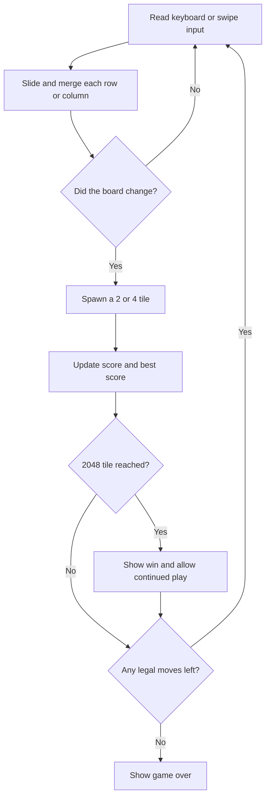

# 2048

A polished, responsive take on the classic number puzzle, built with Vue 3, TypeScript, and Vite. Play it on desktop or swipe on your phone.

**Play:** [oscarmmi.github.io/2048](https://oscarmmi.github.io/2048/)

## How to play

- Slide every tile with the arrow keys or **WASD**. On touch screens, swipe in the direction you want to move.
- Matching tiles merge into one. Each merge adds the new tile's value to your score.
- A new **2** (90%) or **4** (10%) appears after every successful move.
- Reach **2048** to win; choose **Keep playing** to continue past it.
- **R** starts a new game. **Z** undoes your last move. Your best score is saved in this browser.

## Run locally

```sh
npm install
npm run dev
```

Run game-logic tests and create a production build:

```sh
npm test
npm run build
```

## Game loop



## Built with

- Vue 3 + TypeScript
- Vite
- Vitest
